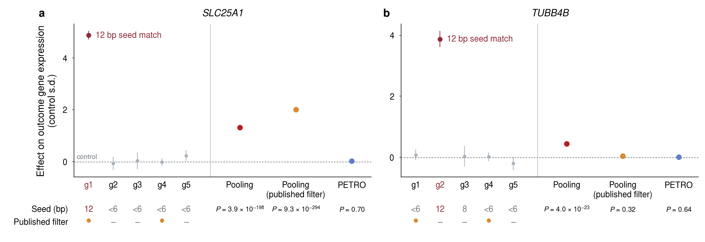

# PETRO

PETRO (perturbation effect estimation robust to off-target bias) is a causal inference framework
for Perturb-seq. It estimates the on-target perturbation effect from the effects of several guides
for the same target. For each outcome, an unknown minority of these guides can have off-target
effects of any sign and size.

PETRO weights each guide by its precision and by its agreement with the other guides, separately
for each outcome. It estimates and tests the on-target perturbation effect (Γ) and the regulatory
effect (α), with parametric and permutation P values. This repository contains the Python
implementation of PETRO and two examples.

## System requirements

- Python 3.10 or later, with NumPy, SciPy, pandas and statsmodels.
- Numba is optional. It makes the tests faster.
- Matplotlib draws the example figures.
- The edgeR adapter needs R with edgeR and jsonlite.
- No special hardware is necessary.

We tested PETRO on Ubuntu 22.04 with Python 3.11, NumPy 2.2, SciPy 1.16, pandas 2.3, statsmodels
0.14, Numba 0.61 and matplotlib 3.10. We tested the edgeR adapter with R 4.4, edgeR 4.4 and
jsonlite 2.0.

## Installation

Run this command in the repository folder. The installation takes approximately one minute.

```bash
pip install ".[numba,plot]"
```

For the DESeq2 adapter, use `pip install ".[deseq2]"`.

## Usage

```python
import petro
from petro.adapters import fit_ols

# y: outcome of each cell. labels: 0 for control cells, 1 to G for the guides of one target.
gamma, covariance, _ = fit_ols(y, labels)
result = petro.fit(gamma, covariance)
result.estimate

# Parametric P values
petro.pointwise_test(result, covariance)
petro.worst_case_test(result, covariance)

# Permutation P values
petro.permutation_test(y, labels, "ols", test="pointwise")
petro.permutation_test(y, labels, "ols", test="worst_case")
```

For count data, use `fit_nb(y, labels, theta=theta)`. This function returns two covariances. Give
`effects.working` to `petro.fit`. Give `effects.sampling` to the tests. For the parametric
worst-case test, use `petro.worst_case_test_nb`. For permutation P values, use
`petro.permutation_test(y, labels, "nb", theta=theta, test=...)`.

For the regulatory effect α, use `fit_ols_pair` or `fit_nb_pair` with `petro.fit_alpha`. For
pseudobulk data, use `fit_deseq2` or `read_edger`. The docstrings give more information.

## Examples

Run the examples in the repository folder. They write their results to `examples/output/`. The
expected results are in `examples/expected/`.

```bash
python examples/1_real_data.py                            # about 5 s
python examples/2_simulation.py                           # about 25 s
python examples/2_simulation.py --inference permutation   # optional, about 80 s
python examples/3_plot_simulation.py
```

The first run also compiles the Numba routines. This adds approximately 25 s.

- `1_real_data.py` uses five guides that target ZNF618 in the RPE-1 CRISPRa screen of
  [Southard et al. (2025)](https://doi.org/10.1038/s41588-025-02284-1). It compares PETRO and
  Pooling at two outcomes. PETRO P values can change slightly with a different BLAS library.
- `2_simulation.py` is a simplified version of the simulation in the accompanying paper. It
  calculates the bias, false rejection and power of Pooling and PETRO. `3_plot_simulation.py` draws
  the figures. The default run uses 50 replicates per setting, so each rate has a Monte Carlo
  standard error of up to 7 percentage points. The expected figures use 2,000 replicates and 999
  draws, so their standard errors are at most 1.1 percentage points. To make them, add
  `--replicates 2000 --draws 999` to both simulation commands. This takes approximately 45 minutes
  on one core, plus approximately 4.5 hours for the permutation round.



## License

The code is available under the MIT license (see `LICENSE`). The file `examples/data/znf618.npz`
comes from the processed RPE-1 data of Southard et al.
([Zenodo record 15213619](https://doi.org/10.5281/zenodo.15213619)) and from their Supplementary
Table S4. We calculated the seed matches in this file for the accompanying paper. We share this
file under [CC BY 4.0](https://creativecommons.org/licenses/by/4.0/).
